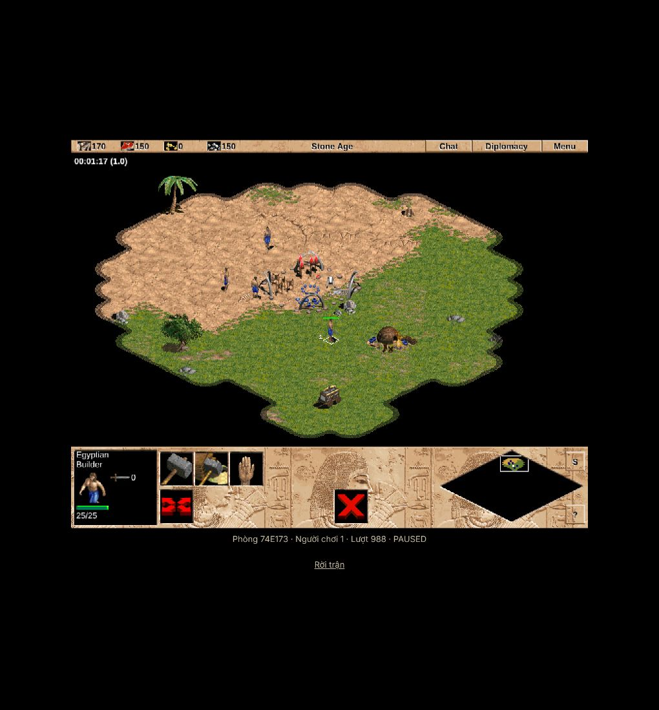

# Age of Empires: Rise of Rome in WebAssembly

This project runs **Age of Empires: Rise of Rome** in the browser by compiling the recovered C++ source of the
game ([dcostap/aoe1-decomp](https://github.com/dcostap/aoe1-decomp)) to WebAssembly. The game's own `WinMain`,
game loop, screens and DirectPlay networking run unmodified. A Windows compatibility layer written for this
port implements the Win32, GDI, DirectDraw, DirectSound, MCI and DirectPlay calls they make, on top of browser
APIs.

No game data is included. You need your own copy of the game. The port targets the retail 1.0a
`EMPIRESX.EXE` (SHA-256 `a8d8cfb2…4b72`).



## Status

- **Multiplayer works** from start to finish through the game's own menus: connection list, game list, lobby
  with chat and ready flags, match, and dropped-player handling. Up to 8 players, each in a browser window on
  this machine or on the LAN. Packets go through the WebSocket relay of the Go server in `server/`, which
  runs many matches at once.
- Sound effects, MIDI music (SpessaSynth + GeneralUser GS soundfont), intro videos and the WinHelp file
  (converted to HTML) work.
- A widescreen game view is optional (`?wide=0` keeps the original 4:3).
- **Single player, campaigns and the Scenario Builder are out of scope for now.** Their screens are part of
  the game code, but they haven't been ported or tested.
- The recovered source is a 1998-07-17 beta, not the retail build. The known retail differences are being
  ported; the port is not yet proven to behave 1:1 with the retail EXE. See [docs/PLAN.md](docs/PLAN.md).
- The port can't play over the network against the Windows game.

## Requirements

- Your own Age of Empires + Rise of Rome installation (the folder that contains `EMPIRESX.EXE`).
- [Go](https://go.dev/dl/) 1.26+ (the server), Python 3 (build and data tools, standard library only) and
  Node.js (tests).
- [Emscripten](https://emscripten.org/docs/getting_started/downloads.html) to build the engine (tested with
  emsdk 7.0.0). Pass its location with `--sdk`.
- Optional: `ffmpeg` (converts the intro videos), and `clang` + `wasm-ld` (the standalone format readers
  used by some tests).

## Quick start

```sh
# 1. Build the game (optimized) and copy it into web/engine/
python3 engine/build.py --sdk /path/to/emsdk --jobs 8 --game --release --web

# 2. Copy your game folder into web/game/ (read only; converts videos and help)
python3 tools/prepare_native.py '/path/to/Age of Empires'

# 3. Optional: download the MIDI synthesizer, soundfont and the lobby's fonts (hash-checked)
python3 tools/fetch_vendor.py

# 4. Build the server, run it from the repository root, and open http://127.0.0.1:8788/
(cd server && go build -o build/aoe-server .)
server/build/aoe-server           # -host 0.0.0.0 to allow other machines on the LAN; -port to change it
```

Don't open the HTML file through `file://`. The page needs the local server for the WASM, the game files and
the multiplayer relay.

### Docker

The Dockerfile builds two images. **Neither contains game data.**

- `aoe-wasm` (the default target) holds the Go server, the page, the release engine (built with
  Emscripten) and the music files. The server is a static binary on distroless. The image is about 36 MB
  compressed, most of it the soundfont.
- `aoe-wasm-prepare` (`--target prepare`) holds Python and ffmpeg. It copies your game folder, mounted at
  `/game`, into the `aoe-data` volume. When the volume is already prepared, it does nothing; `--force`
  prepares again.

CI (`.github/workflows/ci.yml`) publishes both images to the GitHub Container Registry from `main`
(`latest`) and from `v*` tags (`1.2.3`, `1.2`): `ghcr.io/chiengyn/aoe-wasm` and
`ghcr.io/chiengyn/aoe-wasm-prepare`. Use them in place of the local tags below, or build them yourself:

```sh
docker build -t aoe-wasm .                    # --build-arg MUSIC=0 leaves out the MIDI synth and soundfont
docker build --target prepare -t aoe-wasm-prepare .
docker run --rm -v aoe-data:/app/web/game -v "/path/to/Age of Empires:/game:ro" aoe-wasm-prepare
docker run -d --name aoe -p 8788:8788 -v aoe-data:/app/web/game:ro aoe-wasm
```

Or set `AOE_GAME_DIR=/path/to/Age of Empires` (in the shell or a `.env` file) and run
`docker compose up -d --build`, which prepares the volume first and then starts the server. `PORT`
changes the port inside the container.

Behind a TLS reverse proxy (for example nginx or Caddy), forward the `Host` header and allow the
WebSocket upgrade on `/api/dplay`. The page then connects over `wss://` on its own. Everything else is
static files.

Don't publish a server with the game data on the open internet. The prepared files are the copyrighted
game, so keep the server private (LAN, VPN, or behind authentication on the proxy).

### Playing multiplayer

`http://127.0.0.1:8788/` is the room lobby:

1. Pick a name. The lobby keeps it in the browser (localStorage), and other players see you by it.
2. **Create a room**: give it a name, and a password if only invited players should join. Without a
   password, anyone can join.
3. Or **Join a room**: browse or search the rooms (by room or host name) and press **Join**. A locked room
   asks for its password first. **Copy invite link** in a room gives a link that opens the lobby on it.
4. The game opens straight on the room's game setup screen. Players press **I'm Ready!**, and the host
   presses **Start Game**. **Leave room**, or the game's **Cancel**, goes back to the lobby.

Each player needs their own browser window. Chrome throttles background tabs, so two tabs in one window
don't work well.

### Debugging page

`native.html` is the game on its own, with its engine log and the options below. It goes through the game's
own menus: **Multiplayer**, a name, **Browser Connection For DirectPlay**, then **Create**, or **Show
Games** and **Join**. It lists every room on the server, but can't join a locked one (the game's own
screens never ask for a password).

| URL parameter | Effect |
|---|---|
| `?wide=0` | Keep the game screen at 4:3. By default it widens to fit the window, up to 2.4:1. Menus are always 4:3. |
| `?data=<name>` | Play a second edition prepared with `tools/prepare_native.py --out <name> <folder>` |
| `?cmd=<args>` | Game command line (default `NODXCHECK`), e.g. `NOSTARTUP` to skip the intro videos |
| `?autostart` | Start without the click-to-start screen (the browser may then block sound) |

## Server

`server/build/aoe-server` serves `web/` and relays the game's DirectPlay traffic over the `/api/dplay`
WebSocket. It runs any number of matches at the same time; each session has its own lock, so matches don't
wait on each other.

| Flag / endpoint | Meaning |
|---|---|
| `-host`, `-port` | Listen address (default `127.0.0.1:8788`; `PORT` sets the default port) |
| `-web` | Folder to serve (default `web`, relative to the working directory) |
| `-log-requests` | Log every file request |
| `/healthz` | JSON: sessions, players, connections, relayed frames, dropped clients |
| `/api/rooms` | JSON: the rooms (sessions) for the lobby: name, host, players, locked, open |
| `/api/rooms/check` | POST `{id, password}`: whether a player could join now. Limited to 20 checks a minute per address |
| `aoe-server healthcheck` | Exits 0 when the local server answers `/healthz` (used by the Docker image) |

Room passwords stay on the server. Session lists and descriptions carry only a "password required" flag,
and the relay checks the password when a player joins.

A client that stops reading is disconnected once 32 MiB are queued for it, so one stalled browser can't
hold up its match. WebSocket pings every 30 s keep idle lobbies open through proxies.

`server/loadtest` simulates matches against a running server and checks every message. Each player
broadcasts at a fixed rate, and every message must arrive exactly once, in order, and only within its own
match. Measured on one 22-core machine, with the load generator running on the same machine:

| Load (8 players per match, 20 messages/s each) | Go server | Former Python server |
|---|---|---|
| 50 matches (400 connections, 56k deliveries/s) | p50 3.6 ms, p99 8 ms | p50 48 ms, p99 54 ms |
| 200 matches (1,600 connections, 224k deliveries/s) | p50 18 ms, p99 35 ms | fell behind: p50 12 s |

The relay counted about 18.6k frames in and 31.5k out for one real 8-player match in
`test_native_multiplayer.mjs` (lobby plus 40 s of play). Static files are served with revalidation
(`Cache-Control: no-cache`, 304 when unchanged) but without compression. For many players, put a CDN or a
compressing proxy in front of the static files.

## Repository layout

```text
engine/              The game engine compiled to WASM
  upstream/          Vendored recovered source (aoe1-decomp, pinned commit, CC0); the port's changes to it
                     are recorded in port.patch and port-changes.json
  platform/          Windows layer: win32_*.cpp (kernel, user, GDI, DirectDraw, DirectSound/MCI, DirectPlay,
                     message loop), C versions of the assembly drawing routines, Windows headers
  diagnostics/       Headless "probe" entry points used by the Node tests, plus the list of Windows APIs
                     that are still unported
  build.py           Compiles upstream + platform with Emscripten; links game and/or probe
web/                 The pages: index.html + lobby.mjs/.css (room lobby), native.html (debugging page).
                     game-host.mjs (canvas, input, help overlay), native-worker.mjs (runs the game in a
                     Web Worker), native-room.mjs (room launch), native-media/-midi/-dplay/-storage.mjs
                     (audio, music, network, IndexedDB saves), aoe-fonts.mjs (canvas fonts standing in
                     for Windows fonts), cp1252.mjs (the game's code page)
server/              Go server: main.go (static files, /api/dplay WebSocket, /healthz), rooms.go (lobby
                     API), relay/ (DirectPlay
                     sessions and routing), loadtest/ (many simulated matches against a running server)
tools/               Python tools: prepare_native.py (game data), convert_help.py (WinHelp to HTML),
                     fetch_vendor.py, prepare_test_data.py (test data), verify_*.py / compare_versions.py
                     (retail EXE checks)
formats/             Standalone C readers for DRS/SLP/palettes (assets.c) and DAT (dat.c), built to small
                     WASM modules by formats/build.py; the tests use them to check the engine independently
tests/               Node and Python test suites; tests/lib/ holds the JS wrappers they share
docs/                PLAN.md (port plan and detailed progress log) and images
reports/             Output of tests and tools (git-ignored)
Dockerfile, docker/  Server and prepare images, the prepare entry point; compose.yaml
```

Generated folders are git-ignored: `engine/build/`, `engine/build-release/`, `formats/build/`,
`server/build/`, `web/engine/`, `web/game/`, `web/vendor/` and `reports/`.

## Building

`engine/build.py` compiles all 225 recovered C++ files once, then links:

| Command | Output | Use |
|---|---|---|
| `--game` | `engine/build/game.{mjs,wasm}` | Debug game build (`-O1 -g`, assertions); the native tests use it by default |
| `--game --release` | `engine/build-release/game.{mjs,wasm}` | Optimized game build (~2.9 MB, ~0.9 MB gzipped) |
| `--probe` | `engine/build/core-probe.{mjs,wasm}` | Headless diagnostic build for the probe tests |
| `--web` (with `--game`) | `web/engine/` | Copies the game build into the page |

Other flags: `--relink` reuses the objects if every source and header hash still matches, `--only <stem>…`
recompiles selected files, and `--names` (with `--release`) keeps function names for stack traces.

## Tests

The tests run headless in Node against the built WASM. Most need prepared game data.

```sh
# Native game (real WinMain): needs engine/build.py --game and tools/prepare_native.py
node tests/test_native_boot.mjs
node tests/test_native_menu.mjs
node tests/test_native_media.mjs
node tests/test_native_scenarios.mjs
AOE_PLAYERS=4 node tests/test_native_multiplayer.mjs    # AOE_PLAYERS=2..8, AOE_PLAY_SECONDS, AOE_DATA
node tests/test_native_rooms.mjs                        # room launch, passwords, lobby API
python3 tests/test_help_convert.py
python3 tests/test_web_static.py --built

# Probe build and format readers: needs engine/build.py --probe, formats/build.py,
# python3 tools/prepare_test_data.py '<game folder>' and python3 tools/verify_retail_ui.py '<EMPIRESX.EXE>'
node tests/test_assets.mjs
node tests/test_dat.mjs
node tests/test_engine.mjs
node tests/test_session.mjs
node tests/test_combat.mjs
node tests/test_menu.mjs
node tests/test_multiplayer.mjs
node tests/test_game_ui.mjs
node tests/test_battlefield.mjs
```

`AOE_BUILD=build-release` runs the native tests on the release build. Each suite writes a JSON report to
`reports/`. `test_native_multiplayer.mjs` builds and starts the Go server itself (`GO` picks the go command,
`AOE_SERVER` a prebuilt binary).

The server has its own Go tests (protocol, routing, host migration, many concurrent matches, HTTP and
WebSocket handling):

```sh
cd server && go test -race ./...
```

### Checking against the retail EXE

The C versions of the original assembly drawing routines are checked byte for byte against the retail
executable. The check runs its functions in the Unicorn emulator; it doesn't start the game or modify the
EXE. It needs `unicorn` and `pefile` in a separate Python environment:

```sh
python3 tests/test_drawing_oracle.py --exe '/path/to/EMPIRESX.EXE' --out /tmp/aoe-drawing-oracle.json
node tests/test_drawing.mjs /tmp/aoe-drawing-oracle.json
```

`tools/verify_retail_ui.py` and `tools/verify_rng.py` read menu layout and RNG code from the EXE.
`tools/compare_versions.py A B` compares two installations, including the EXE patch sites.

## Credits and licenses

- Recovered engine source: [dcostap/aoe1-decomp](https://github.com/dcostap/aoe1-decomp) at
  `6d6d8b14023aa74e6ac30a6c88229d5b818fb805`, CC0-1.0 (`engine/upstream/LICENSE`).
- `engine/platform/ddraw.h` and `dsound.h` come from MinGW-w64/Wine (LGPL-2.1-or-later); see
  `engine/platform/NOTICE.md`.
- Downloaded by `tools/fetch_vendor.py`, not committed: SpessaSynth (Apache-2.0) and the GeneralUser GS
  soundfont.
- The format readers in `formats/` are new code. They follow the DRS/SLP notes from
  [openage](https://github.com/SFTtech/openage) and the field layout from aoe1-decomp and
  [genieutils](https://github.com/Tapsa/genieutils); no code from those projects is included.
- Age of Empires is a trademark of Microsoft. This project isn't affiliated with or endorsed by Microsoft.
  Game files you prepare stay in the git-ignored `web/game/`. Don't publish them.
